<!-- Generated by scripts/benchmark/publish.py; edit the data or generator. -->

# Media benchmarks

Updated **2026-10-09**. towavue has the lowest representative completion time in **11 of 11 workloads** below, compared with IrfanView for images and MPC-HC/VLC for video and audio. This describes these fixtures on this Windows PC; it does not mean every file or every individual comparison is a statistically established win.

[Overview](#overview) · [Measurement method](#measurement-method) · [Image-open confidence](#image-open-confidence) · [Complete results](#complete-results) · [Environment and builds](#environment-and-builds) · [Data and updates](#data-and-updates)

## Overview

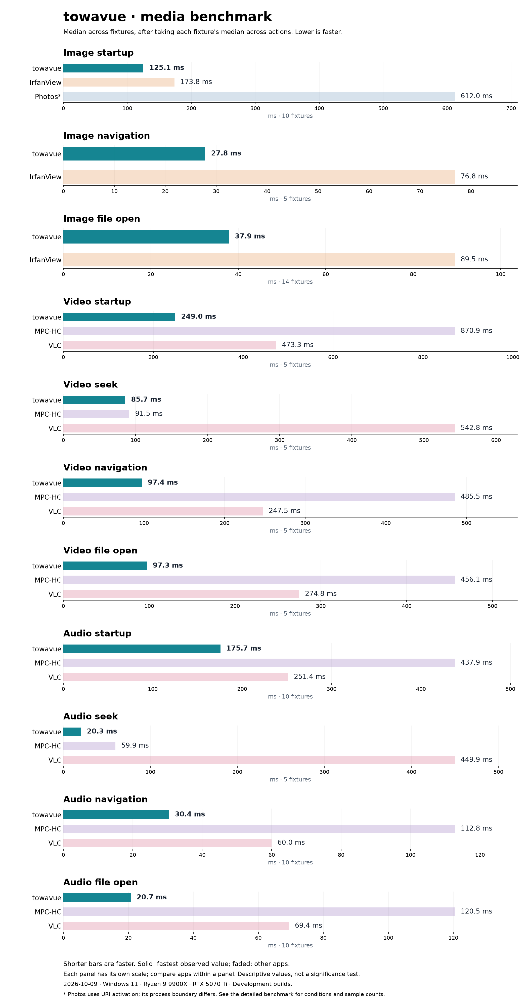

[Scalable overview](benchmarks/overview.svg)

**Shorter bars are faster.** Solid bars mark the lowest observed value; other apps are faded. Each overview panel has its own zero-based scale: compare apps within a panel. Ranking is descriptive, not an aggregate significance test.

| Workload | Fixtures / conditions | towavue | IrfanView | MPC-HC | VLC | Photos* |
|---|---:|---:|---:|---:|---:|---:|
| Image startup | 10 / 10 | 125.14 | 173.78 | — | — | 612.01 |
| Image navigation | 5 / 20 | 27.85 | 76.84 | — | — | — |
| Image file open | 14 / 14 | 37.88 | 89.53 | — | — | — |
| Video startup | 5 / 5 | 249.01 | — | 870.93 | 473.25 | — |
| Video seek | 5 / 5 | 85.75 | — | 91.46 | 542.82 | — |
| Video navigation | 5 / 8 | 97.40 | — | 485.50 | 247.48 | — |
| Video file open | 5 / 5 | 97.34 | — | 456.11 | 274.76 | — |
| Audio startup | 10 / 10 | 175.67 | — | 437.86 | 251.36 | — |
| Audio seek | 5 / 5 | 20.33 | — | 59.91 | 449.90 | — |
| Audio navigation | 10 / 16 | 30.43 | — | 112.75 | 59.98 | — |
| Audio file open | 10 / 10 | 20.74 | — | 120.46 | 69.44 | — |

All values are milliseconds. A dash means that app is not part of that comparison, not that it cannot perform the operation.

**How the bars are aggregated:** start with each measured condition's median. Keep only fixture/action conditions covered by every app listed for that workload. Within each fixture, take the median across actions; then take the median across fixtures. Every fixture has equal weight, regardless of trial count or number of actions. For startup, seek and file open there is one condition per fixture; navigation can have several. This is a typical fixture score, not a pooled-trial median or the duration of a combined workflow. There is no global score across the eleven workloads.

**Photos (asterisk in charts)** is an additional image-startup observation: five URI activation requests per fixture, potentially retaining a windowless spare process. It has a different process boundary from command-launched startup, and is not used to establish a paired cross-app significance claim.

## Measurement method

Startup launches an app with the media file; navigation, seek and file open operate in an already-running app. File open uses each app's direct file-entry interface. Windows file/folder dialogs and their derived timing endpoints are excluded throughout. Image startup and image file open therefore measure different operations.

The generated corpus covers JPEG (including EXIF rotation and sRGB profiles), PNG/alpha, WebP, AVIF, TIFF, GIF/WebP animation; H.264, HEVC 10-bit, VP9, AV1 10-bit and long-GOP H.264; and WAV, FLAC, MP3, AAC/M4A and Opus. Homogeneous image folders, the 1,000-file folder and mixed-format sessions are distinct fixtures. Audio startup/open/navigation include both 12-second and 180-second files. These synthetic format fixtures are not a representative sample of photographs, movies or music.

Files are warm and windows are normalized to an 800 × 650 client. Prepared profiles, fixture identity checks and owned-window checks are used; warmup/calibration observations are excluded. Measurements are sequential and operation order is randomized within blocks where the protocol permits. A fresh process block can contain several related operations: those operations are not independent samples. The tables preserve successful/attempted operations and block counts.

Visual completion is desktop capture recognizing the expected fixture, including sampling/capture and window normalization overhead. It is not physical display onset. Audio completion detects the expected tone in two consecutive WASAPI loopback packets; it includes buffering and detector confirmation, and is not acoustic onset or sample-accurate timing. No microphone recording is used. Fit/resampling settings do not certify identical filtering or full-source image quality.

The broad refresh uses three measured blocks, the retained direct-open study ten, qualified image startup thirty, and the targeted image-open follow-up thirty new paired blocks. Other qualified navigation/seek counts are listed below. Small cohorts describe speed but give unstable tail estimates. Table p95 values retain their source method (nearest-rank in the broad refresh; linear interpolation in the retained direct-open study). No aggregate p95 or aggregate confidence interval is inferred from these summaries.

## Image-open confidence

The latest six-condition follow-up used thirty new paired blocks per condition: all 540 measured operations succeeded; eighteen warmup operations and calibration are excluded. Earlier exploratory samples are not pooled. Mixed-folder targets in this follow-up are JPEG 1080p, AVIF and EXIF rotation only; they do not reproduce the entire older ten-format session.

The gap is **towavue minus IrfanView**, computed within paired blocks. Its median is not the difference between the marginal medians in the bar charts. Exact order-statistic intervals use a six-comparison Bonferroni correction. Under independent, stable blocks, simultaneous family coverage is at least 95% (the discrete bound is 96.87%). An interval crossing zero is unresolved, not evidence of equivalent speed.

| Condition | Median paired gap (ms) | Simultaneous interval (ms) | towavue lower blocks | Recorded-time conclusion |
|---|---:|---:|---:|---|
| JPEG 1080p | -7.29 | [-8.87, -3.85] | 30/30 | towavue faster |
| JPEG 24 MP | -0.16 | [-4.53, +5.58] | 15/30 | unresolved |
| 1,000 small JPEGs | -11.43 | [-13.40, -6.87] | 28/30 | towavue faster |
| Mixed: JPEG 1920 x 1080 | -18.04 | [-20.55, -10.17] | 26/30 | towavue faster |
| Mixed: AVIF 4K | -46.47 | [-49.72, -41.75] | 30/30 | towavue faster |
| Mixed: JPEG EXIF rotation | +1.18 | [-16.88, +7.47] | 14/30 | unresolved |

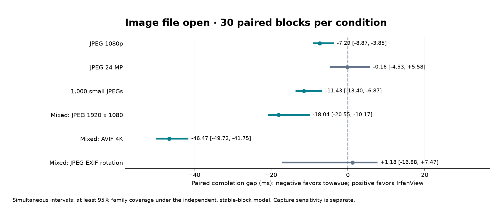

[Scalable confidence chart](benchmarks/image-open-confidence.svg)

Four conditions favor towavue in recorded completion timestamps; JPEG 24 MP and EXIF rotation remain unresolved. Capture timing adds a separate uncertainty: the median capture call took 15.45 ms. Conservatively propagating last-absent/first-present bounds leaves only AVIF entirely below zero; the other five capture-sensitivity intervals cross zero. The public data includes all thirty paired gaps and their lower/upper bounds for each condition. These statistical intervals do not remove systematic timing bias.

## Complete results

All **366 comparison cells** are retained below, including settled viewport, video soundtrack and playback cadence observations that are not in the eleven-workload overview. No towavue-only or Windows-dialog comparisons are included.

**Table cells:** median / p95 in milliseconds; successful/attempted operations; process or session blocks; study ID. A lower–upper median is a capture-observation bound, not a confidence interval. Charts plot the upper observed median, with gray capture-bound segments where available. Build attribution is in the [study inventory](#study-inventory).

[Image and animation startup](#image-startup) · [Image folder navigation](#navigation) · [Mixed image and animation navigation](#mixed) · [Video startup](#video-startup) · [Audio startup](#audio-startup) · [Video and audio seek](#seek) · [Video and audio navigation](#media) · [Open file](#direct-open) · [Video soundtrack startup](#video-audio-startup) · [Playback cadence](#pacing)

### Image and animation startup

New process with a file path. Recognition is the overview endpoint; settled viewport is a separate observation. Photos uses URI activation with a potentially retained spare process, so its boundary differs.

#### Startup — settled viewport

| Fixture | towavue | IrfanView |
|---|---:|---:|
| JPEG 1920 x 1080 | 310.03 / 326.91 30/30; 30 blocks; study-15 | 311.76 / 323.16 30/30; 30 blocks; study-15 |
| JPEG 24 MP | 306.92 / 327.85 30/30; 30 blocks; study-15 | 313.56 / 320.93 30/30; 30 blocks; study-15 |
| PNG with alpha 4K | 306.90 / 330.64 30/30; 30 blocks; study-15 | 309.38 / 323.89 30/30; 30 blocks; study-15 |
| WebP 4K | 304.53 / 325.41 30/30; 30 blocks; study-15 | 311.65 / 325.74 30/30; 30 blocks; study-15 |
| AVIF 4K | 312.24 / 349.50 30/30; 30 blocks; study-15 | 312.41 / 319.62 30/30; 30 blocks; study-15 |
| TIFF 4K | 311.04 / 329.22 30/30; 30 blocks; study-15 | 312.54 / 320.63 30/30; 30 blocks; study-15 |
| JPEG EXIF rotation | 306.62 / 325.92 30/30; 30 blocks; study-15 | 312.26 / 322.56 30/30; 30 blocks; study-15 |
| JPEG sRGB profile 4K | 304.92 / 328.40 30/30; 30 blocks; study-15 | 310.52 / 320.41 30/30; 30 blocks; study-15 |

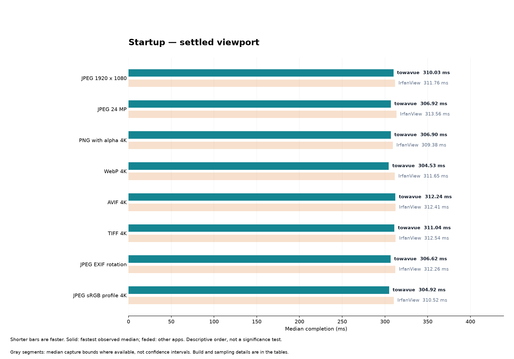

[Scalable chart](benchmarks/figures/image-startup-startup-converged.svg)

#### Startup — recognizable content

| Fixture | towavue | IrfanView | Photos* |
|---|---:|---:|---:|
| JPEG 1920 x 1080 | 94.63–125.53 / 134.39 30/30; 30 blocks; study-15 | 103.28–133.13 / 146.50 30/30; 30 blocks; study-15 | 621.25–655.78 / 672.47 5/5; 5 blocks; study-01 |
| JPEG 24 MP | 140.24–171.45 / 201.37 30/30; 30 blocks; study-15 | 47.89–221.45 / 237.00 30/30; 30 blocks; study-15 | 538.00–562.87 / 573.56 5/5; 5 blocks; study-01 |
| PNG with alpha 4K | 94.43–124.02 / 131.07 30/30; 30 blocks; study-15 | 47.87–186.30 / 193.41 30/30; 30 blocks; study-15 | 550.89–607.22 / 642.87 5/5; 5 blocks; study-01 |
| WebP 4K | 177.22–208.60 / 218.82 30/30; 30 blocks; study-15 | 48.00–246.85 / 263.22 30/30; 30 blocks; study-15 | 565.97–591.04 / 612.61 5/5; 5 blocks; study-01 |
| AVIF 4K | 97.95–126.79 / 135.59 30/30; 30 blocks; study-15 | 47.53–202.03 / 209.99 30/30; 30 blocks; study-15 | 589.91–613.88 / 685.41 5/5; 5 blocks; study-01 |
| TIFF 4K | 95.04–125.24 / 133.61 30/30; 30 blocks; study-15 | 47.98–173.45 / 181.51 30/30; 30 blocks; study-15 | 558.68–613.92 / 657.83 5/5; 5 blocks; study-01 |
| JPEG EXIF rotation | 86.91–123.11 / 132.77 30/30; 30 blocks; study-15 | 49.93–130.37 / 145.52 30/30; 30 blocks; study-15 | 635.48–650.22 / 677.03 5/5; 5 blocks; study-01 |
| JPEG sRGB profile 4K | 94.74–125.05 / 133.95 30/30; 30 blocks; study-15 | 47.78–147.70 / 157.39 30/30; 30 blocks; study-15 | 574.68–613.91 / 724.62 5/5; 5 blocks; study-01 |
| Animated GIF 960 x 540 | 93.33–123.97 / 128.89 30/30; 30 blocks; study-15 | 47.69–174.10 / 189.89 30/30; 30 blocks; study-15 | 545.62–577.88 / 650.45 5/5; 5 blocks; study-01 |
| Animated WebP 960 x 540 | 93.90–124.05 / 129.69 30/30; 30 blocks; study-15 | 47.64–144.53 / 160.10 30/30; 30 blocks; study-15 | 583.22–610.14 / 695.82 5/5; 5 blocks; study-01 |

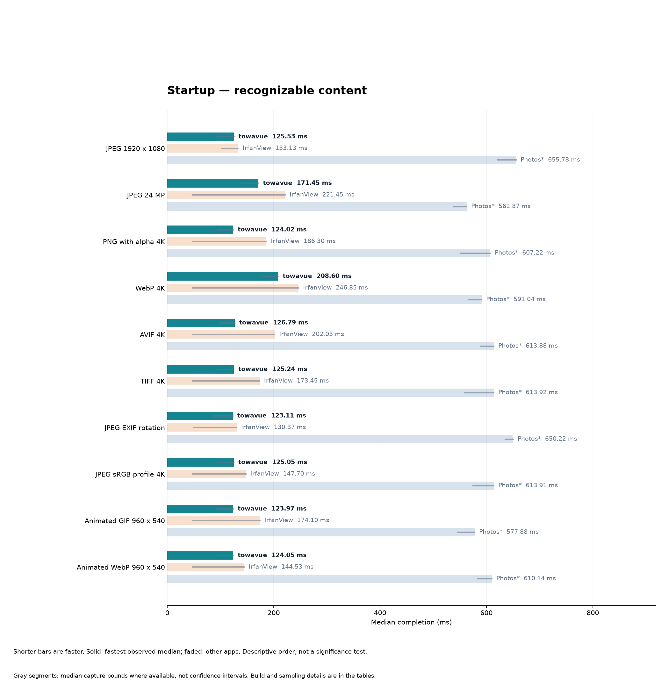

[Scalable chart](benchmarks/figures/image-startup-startup-recognizable.svg)

### Image folder navigation

Next, previous, first and last file in homogeneous image folders. The large folder contains 1,000 small JPEGs. Three process blocks, except the qualified JPEG 24 MP study with ten blocks.

#### Jump to first file — visual completion

| Fixture | towavue | IrfanView |
|---|---:|---:|
| JPEG 1080p | 0.00–13.61 / 16.93 3/3; 3 blocks; study-05 | 0.06–38.45 / 42.53 3/3; 3 blocks; study-05 |
| JPEG 24 MP | 0.00–20.20 / 42.76 10/10; 10 blocks; study-13 | 103.39–141.96 / 153.16 10/10; 10 blocks; study-13 |
| 1,000 small JPEGs | 0.00–20.82 / 22.78 3/3; 3 blocks; study-05 | 0.00–22.49 / 36.58 3/3; 3 blocks; study-05 |
| PNG 4K | 0.00–14.84 / 15.19 3/3; 3 blocks; study-05 | 58.52–92.36 / 93.90 3/3; 3 blocks; study-05 |

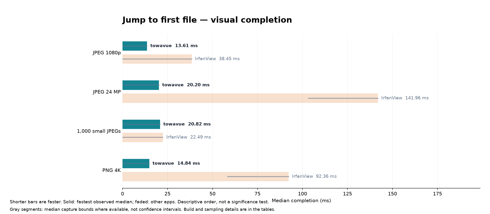

[Scalable chart](benchmarks/figures/navigation-distant_first-latency.svg)

#### Jump to last file — visual completion

| Fixture | towavue | IrfanView |
|---|---:|---:|
| JPEG 1080p | 0.06–33.68 / 34.43 3/3; 3 blocks; study-05 | 0.05–36.67 / 40.62 3/3; 3 blocks; study-05 |
| JPEG 24 MP | 10.43–49.42 / 68.14 10/10; 10 blocks; study-13 | 104.93–142.04 / 149.87 10/10; 10 blocks; study-13 |
| 1,000 small JPEGs | 0.08–35.29 / 35.68 3/3; 3 blocks; study-05 | 0.05–33.70 / 34.06 3/3; 3 blocks; study-05 |
| PNG 4K | 0.06–36.98 / 37.99 3/3; 3 blocks; study-05 | 61.22–96.01 / 101.79 3/3; 3 blocks; study-05 |

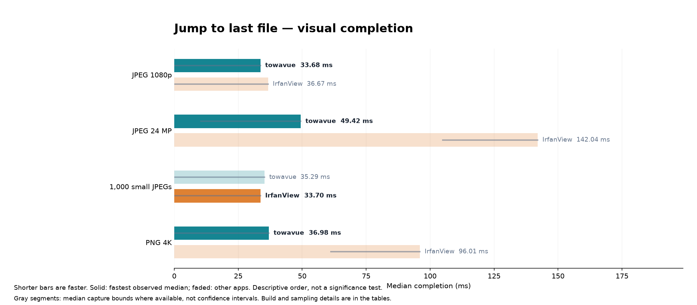

[Scalable chart](benchmarks/figures/navigation-distant_last-latency.svg)

#### Next file — visual completion

| Fixture | towavue | IrfanView |
|---|---:|---:|
| JPEG 1080p | 0.00–19.69 / 34.67 24/24; 3 blocks; study-05 | 0.06–34.05 / 37.60 24/24; 3 blocks; study-05 |
| JPEG 24 MP | 9.91–54.89 / 65.47 80/80; 10 blocks; study-13 | 99.45–136.36 / 145.06 80/80; 10 blocks; study-13 |
| 1,000 small JPEGs | 0.00–20.16 / 35.50 24/24; 3 blocks; study-05 | 0.06–32.75 / 37.71 24/24; 3 blocks; study-05 |
| PNG 4K | 0.06–37.64 / 42.43 24/24; 3 blocks; study-05 | 58.68–93.94 / 99.94 24/24; 3 blocks; study-05 |

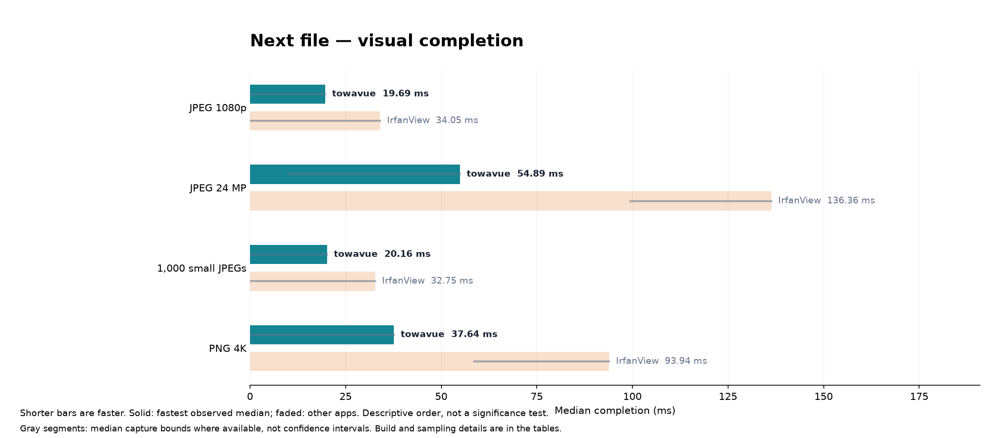

[Scalable chart](benchmarks/figures/navigation-next-latency.svg)

#### Previous file — visual completion

| Fixture | towavue | IrfanView |
|---|---:|---:|
| JPEG 1080p | 0.00–15.35 / 19.64 24/24; 3 blocks; study-05 | 0.07–36.37 / 43.20 24/24; 3 blocks; study-05 |
| JPEG 24 MP | 0.06–46.64 / 62.91 80/80; 10 blocks; study-13 | 102.18–140.47 / 146.85 80/80; 10 blocks; study-13 |
| 1,000 small JPEGs | 0.00–18.91 / 35.17 24/24; 3 blocks; study-05 | 0.06–32.24 / 37.73 24/24; 3 blocks; study-05 |
| PNG 4K | 0.06–34.62 / 43.36 24/24; 3 blocks; study-05 | 60.16–96.30 / 104.26 24/24; 3 blocks; study-05 |

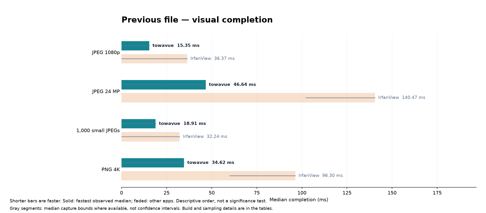

[Scalable chart](benchmarks/figures/navigation-previous-latency.svg)

### Mixed image and animation navigation

The same four navigation commands in a Shell-ordered mixed-format folder; three process blocks.

#### Jump to first file — visual completion

| Fixture | towavue | IrfanView |
|---|---:|---:|
| Mixed images / animation | 0.00–19.40 / 20.55 3/3; 3 blocks; study-04 | 0.05–36.44 / 37.53 3/3; 3 blocks; study-04 |

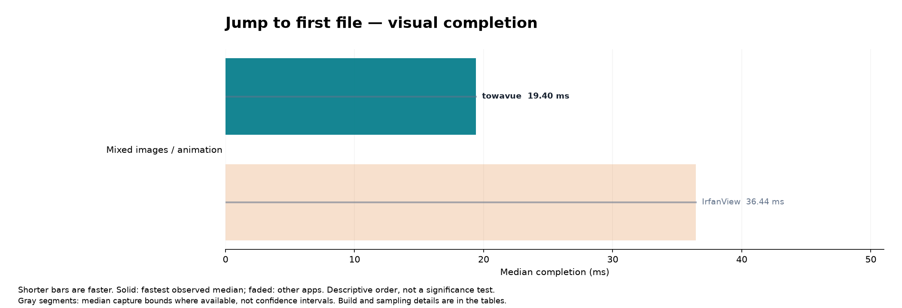

[Scalable chart](benchmarks/figures/mixed-distant_first-latency.svg)

#### Jump to last file — visual completion

| Fixture | towavue | IrfanView |
|---|---:|---:|
| Mixed images / animation | 18.03–50.80 / 51.88 3/3; 3 blocks; study-04 | 20.84–58.50 / 62.34 3/3; 3 blocks; study-04 |

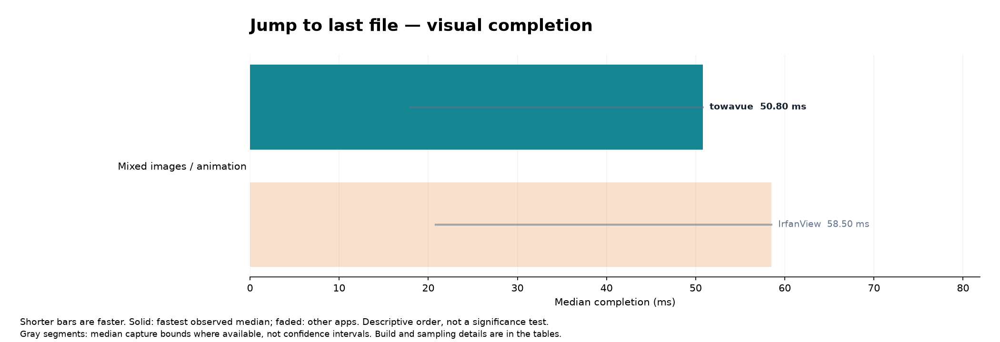

[Scalable chart](benchmarks/figures/mixed-distant_last-latency.svg)

#### Next file — visual completion

| Fixture | towavue | IrfanView |
|---|---:|---:|
| Mixed images / animation | 0.07–36.29 / 59.32 24/24; 3 blocks; study-04 | 65.36–95.18 / 162.55 24/24; 3 blocks; study-04 |

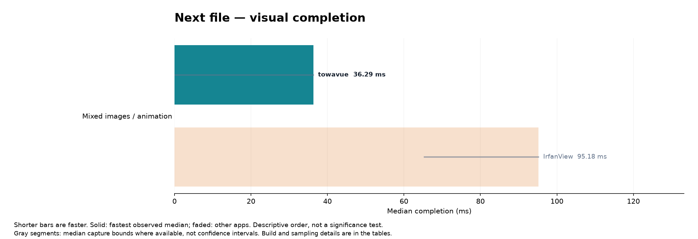

[Scalable chart](benchmarks/figures/mixed-next-latency.svg)

#### Previous file — visual completion

| Fixture | towavue | IrfanView |
|---|---:|---:|
| Mixed images / animation | 0.00–15.52 / 41.27 24/24; 3 blocks; study-04 | 58.95–96.81 / 162.79 24/24; 3 blocks; study-04 |

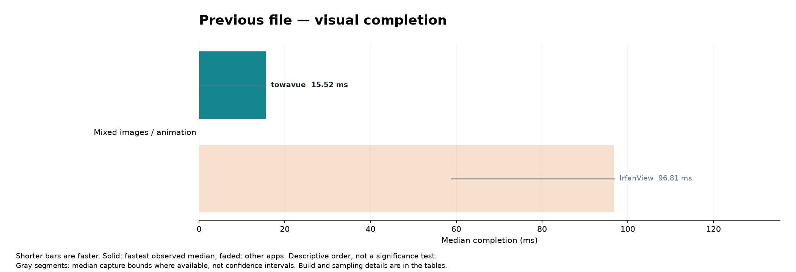

[Scalable chart](benchmarks/figures/mixed-previous-latency.svg)

### Video startup

New process to recognition of the expected video frame; three measured blocks.

#### Startup — recognizable content

| Fixture | towavue | MPC-HC | VLC |
|---|---:|---:|---:|
| H.264 1080p | 198.88–243.86 / 270.25 3/3; 3 blocks; study-09 | 833.37–864.37 / 889.73 3/3; 3 blocks; study-09 | 400.83–435.40 / 443.22 3/3; 3 blocks; study-09 |
| HEVC 4K 10-bit | 197.01–239.47 / 306.28 3/3; 3 blocks; study-09 | 832.01–862.32 / 893.77 3/3; 3 blocks; study-09 | 440.79–473.53 / 494.53 3/3; 3 blocks; study-09 |
| VP9 1080p | 260.93–295.62 / 298.56 3/3; 3 blocks; study-09 | 889.45–920.21 / 998.19 3/3; 3 blocks; study-09 | 446.87–477.98 / 487.91 3/3; 3 blocks; study-09 |
| AV1 4K 10-bit | 207.33–258.94 / 259.77 3/3; 3 blocks; study-09 | 935.00–962.80 / 1008.47 3/3; 3 blocks; study-09 | 443.56–473.25 / 482.39 3/3; 3 blocks; study-09 |
| H.264 1080p long GOP | 208.91–249.01 / 264.51 3/3; 3 blocks; study-09 | 843.62–870.93 / 902.17 3/3; 3 blocks; study-09 | 422.29–452.44 / 505.00 3/3; 3 blocks; study-09 |

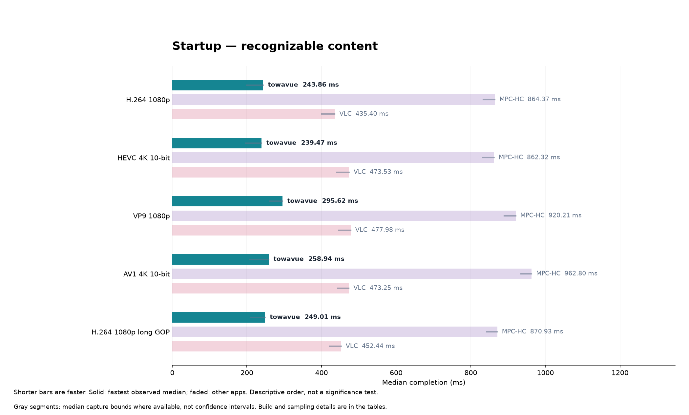

[Scalable chart](benchmarks/figures/video-startup-startup-recognizable.svg)

### Audio startup

New process to loopback detection of the expected audio; 12-second and 180-second fixtures, three measured blocks.

#### Startup — audio detection

| Fixture | towavue | MPC-HC | VLC |
|---|---:|---:|---:|
| FLAC 12 s | 174.51 / 175.56 3/3; 3 blocks; study-02 | 427.02 / 440.96 3/3; 3 blocks; study-02 | 258.89 / 266.07 3/3; 3 blocks; study-02 |
| AAC (M4A) 12 s | 175.70 / 177.91 3/3; 3 blocks; study-02 | 418.85 / 425.42 3/3; 3 blocks; study-02 | 251.08 / 252.33 3/3; 3 blocks; study-02 |
| MP3 12 s | 178.28 / 180.12 3/3; 3 blocks; study-02 | 458.61 / 469.49 3/3; 3 blocks; study-02 | 285.32 / 288.97 3/3; 3 blocks; study-02 |
| Opus 12 s | 175.23 / 219.49 3/3; 3 blocks; study-02 | 464.46 / 464.84 3/3; 3 blocks; study-02 | 241.50 / 250.93 3/3; 3 blocks; study-02 |
| WAV 12 s | 196.69 / 205.98 3/3; 3 blocks; study-02 | 443.74 / 540.52 3/3; 3 blocks; study-02 | 232.66 / 239.95 3/3; 3 blocks; study-02 |
| FLAC 180 s | 175.64 / 186.02 3/3; 3 blocks; study-02 | 420.16 / 427.54 3/3; 3 blocks; study-02 | 260.37 / 261.71 3/3; 3 blocks; study-02 |
| AAC (M4A) 180 s | 176.46 / 179.92 3/3; 3 blocks; study-02 | 429.45 / 440.12 3/3; 3 blocks; study-02 | 251.64 / 255.68 3/3; 3 blocks; study-02 |
| MP3 180 s | 174.45 / 179.16 3/3; 3 blocks; study-02 | 464.56 / 465.20 3/3; 3 blocks; study-02 | 283.94 / 287.18 3/3; 3 blocks; study-02 |
| Opus 180 s | 173.46 / 175.90 3/3; 3 blocks; study-02 | 432.48 / 486.53 3/3; 3 blocks; study-02 | 242.71 / 244.73 3/3; 3 blocks; study-02 |
| WAV 180 s | 189.28 / 197.19 3/3; 3 blocks; study-02 | 443.25 / 449.14 3/3; 3 blocks; study-02 | 234.82 / 239.11 3/3; 3 blocks; study-02 |

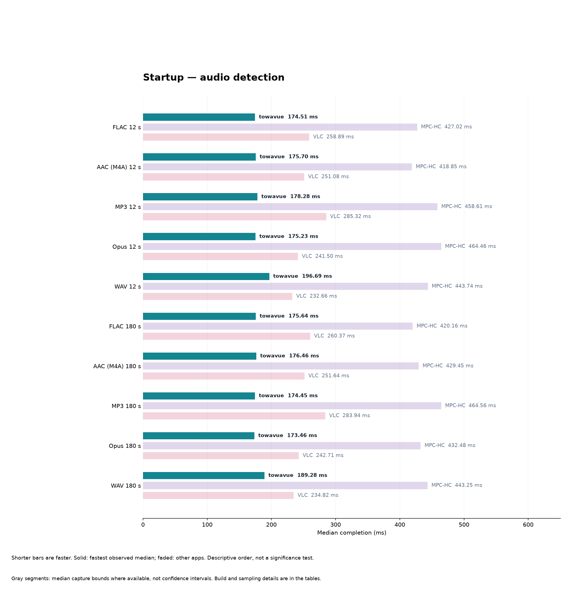

[Scalable chart](benchmarks/figures/audio-startup-startup-audio.svg)

### Video and audio seek

A running player seeks to aligned target positions. Video-frame recognition and audio detection remain separate endpoints. The overview uses video recognition for video seek and audio-only fixtures for audio seek. Qualified towavue/MPC-HC video observations use twelve blocks and PCM WAV ten; other observations use three.

#### Seek — audio detection

| Fixture | towavue | MPC-HC | VLC |
|---|---:|---:|---:|
| AV1 4K 10-bit | 23.49 / 44.12 72/72; 12 blocks; study-12 | 61.35 / 64.95 72/72; 12 blocks; study-12 | 542.46 / 882.83 18/18; 3 blocks; study-08 |
| H.264 1080p | 24.27 / 34.37 72/72; 12 blocks; study-12 | 59.51 / 60.68 72/72; 12 blocks; study-12 | 492.61 / 720.39 18/18; 3 blocks; study-08 |
| H.264 1080p long GOP | 24.69 / 41.30 72/72; 12 blocks; study-12 | 59.60 / 65.21 72/72; 12 blocks; study-12 | 532.74 / 861.87 18/18; 3 blocks; study-08 |
| HEVC 4K 10-bit | 22.48 / 40.93 72/72; 12 blocks; study-12 | 60.24 / 64.74 72/72; 12 blocks; study-12 | 516.04 / 799.76 18/18; 3 blocks; study-08 |
| FLAC | 20.01 / 21.40 18/18; 3 blocks; study-07 | 85.45 / 110.46 18/18; 3 blocks; study-07 | 475.71 / 660.31 18/18; 3 blocks; study-08 |
| AAC (M4A) | 20.68 / 39.68 18/18; 3 blocks; study-07 | 50.42 / 60.48 18/18; 3 blocks; study-07 | 429.56 / 640.95 18/18; 3 blocks; study-08 |
| MP3 | 20.57 / 40.20 18/18; 3 blocks; study-07 | 59.91 / 70.17 18/18; 3 blocks; study-07 | 460.22 / 680.85 18/18; 3 blocks; study-08 |
| Opus | 20.33 / 41.05 18/18; 3 blocks; study-07 | 59.96 / 61.16 18/18; 3 blocks; study-07 | 449.90 / 930.26 18/18; 3 blocks; study-08 |
| PCM WAV | 20.24 / 40.20 60/60; 10 blocks; study-14 | 40.02 / 41.54 60/60; 10 blocks; study-14 | 420.14 / 621.05 18/18; 3 blocks; study-08 |
| VP9 1080p | 23.68 / 44.71 72/72; 12 blocks; study-12 | 70.15 / 76.08 72/72; 12 blocks; study-12 | 509.17 / 841.60 18/18; 3 blocks; study-08 |

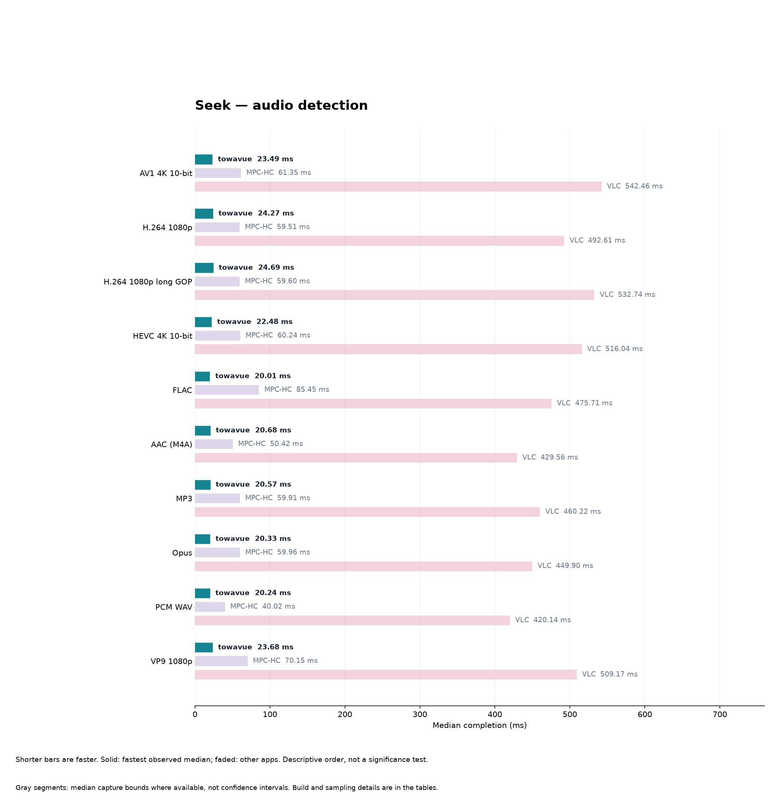

[Scalable chart](benchmarks/figures/seek-seek_aligned-audio.svg)

#### Seek — video frame recognition

| Fixture | towavue | MPC-HC | VLC |
|---|---:|---:|---:|
| AV1 4K 10-bit | 70.76–85.75 / 129.56 72/72; 12 blocks; study-12 | 100.95–115.66 / 195.47 72/72; 12 blocks; study-12 | 560.18–574.36 / 916.99 18/18; 3 blocks; study-08 |
| H.264 1080p | 19.16–33.94 / 51.97 72/72; 12 blocks; study-12 | 24.63–39.38 / 43.02 72/72; 12 blocks; study-12 | 502.09–516.63 / 736.89 18/18; 3 blocks; study-08 |
| H.264 1080p long GOP | 72.90–87.83 / 140.64 72/72; 12 blocks; study-12 | 76.85–91.46 / 149.62 72/72; 12 blocks; study-12 | 552.17–566.05 / 895.01 18/18; 3 blocks; study-08 |
| HEVC 4K 10-bit | 68.32–87.43 / 131.07 72/72; 12 blocks; study-12 | 114.88–129.77 / 217.35 72/72; 12 blocks; study-12 | 490.75–506.26 / 805.67 18/18; 3 blocks; study-08 |
| VP9 1080p | 51.41–65.92 / 100.94 72/72; 12 blocks; study-12 | 53.52–68.28 / 105.97 72/72; 12 blocks; study-12 | 528.11–542.82 / 866.43 18/18; 3 blocks; study-08 |

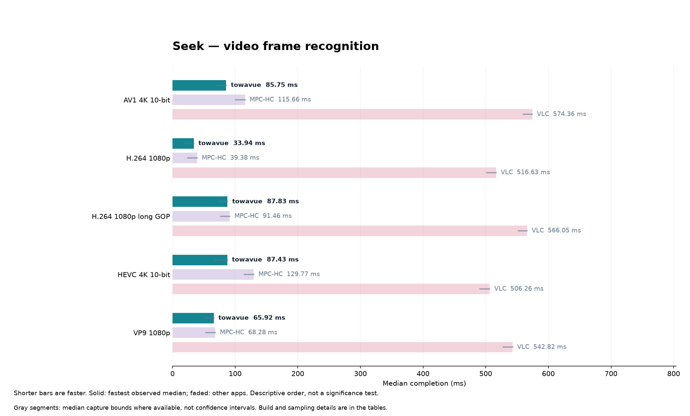

[Scalable chart](benchmarks/figures/seek-seek_aligned-video.svg)

### Video and audio navigation

Next/previous in towavue folders and comparator playlists, in a warm running process. Three process blocks. Within-session towavue resume can apply. Only matching measured case/action pairs enter the overview.

#### Next file — audio detection

| Fixture | towavue | MPC-HC | VLC |
|---|---:|---:|---:|
| FLAC 12 s | 30.86 / 31.51 3/3; 3 blocks; study-03 | 110.63 / 119.56 3/3; 3 blocks; study-03 | 60.26 / 61.44 3/3; 3 blocks; study-03 |
| AAC (M4A) 12 s | 30.90 / 32.08 3/3; 3 blocks; study-03 | 109.83 / 111.13 3/3; 3 blocks; study-03 | 60.34 / 60.40 3/3; 3 blocks; study-03 |
| MP3 12 s | 30.48 / 31.06 3/3; 3 blocks; study-03 | 139.80 / 140.86 3/3; 3 blocks; study-03 | 89.73 / 90.10 3/3; 3 blocks; study-03 |
| Opus 12 s | 30.45 / 31.07 3/3; 3 blocks; study-03 | 109.81 / 110.93 3/3; 3 blocks; study-03 | 49.63 / 50.93 3/3; 3 blocks; study-03 |
| FLAC 180 s | 29.79 / 31.22 3/3; 3 blocks; study-03 | 119.49 / 119.52 3/3; 3 blocks; study-03 | 838.85 / 850.80 3/3; 3 blocks; study-03 |
| AAC (M4A) 180 s | 30.78 / 31.34 3/3; 3 blocks; study-03 | 110.04 / 110.62 3/3; 3 blocks; study-03 | 60.10 / 60.80 3/3; 3 blocks; study-03 |
| MP3 180 s | 30.09 / 30.19 3/3; 3 blocks; study-03 | 139.65 / 140.48 3/3; 3 blocks; study-03 | 89.20 / 90.74 3/3; 3 blocks; study-03 |
| WAV 180 s | 40.61 / 40.61 3/3; 3 blocks; study-03 | 120.32 / 130.14 3/3; 3 blocks; study-03 | 40.68 / 41.02 3/3; 3 blocks; study-03 |

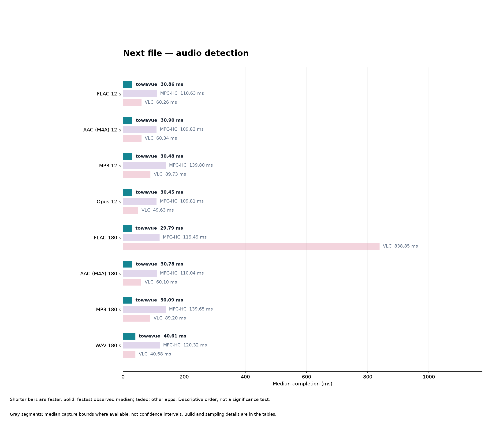

[Scalable chart](benchmarks/figures/media-next-audio.svg)

#### Next file — visual completion

| Fixture | towavue | MPC-HC | VLC |
|---|---:|---:|---:|
| HEVC 4K 10-bit | 26.47–57.39 / 72.72 3/3; 3 blocks; study-03 | 456.89–480.36 / 492.33 3/3; 3 blocks; study-03 | 250.31–279.23 / 281.33 3/3; 3 blocks; study-03 |
| VP9 1080p | 116.78–142.01 / 145.46 3/3; 3 blocks; study-03 | 455.53–479.55 / 484.16 3/3; 3 blocks; study-03 | 241.07–269.04 / 290.76 3/3; 3 blocks; study-03 |
| AV1 4K 10-bit | 57.86–83.20 / 85.20 3/3; 3 blocks; study-03 | 456.93–480.93 / 494.20 3/3; 3 blocks; study-03 | 217.21–241.28 / 248.37 3/3; 3 blocks; study-03 |
| H.264 1080p long GOP | 38.81–67.76 / 101.62 3/3; 3 blocks; study-03 | 468.58–492.09 / 503.23 3/3; 3 blocks; study-03 | 183.48–211.27 / 222.19 3/3; 3 blocks; study-03 |

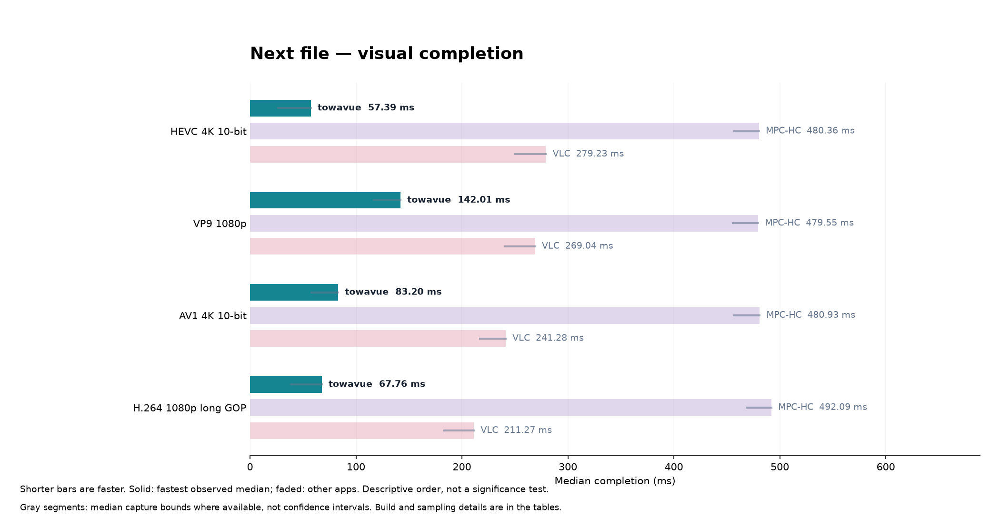

[Scalable chart](benchmarks/figures/media-next-latency.svg)

#### Previous file — audio detection

| Fixture | towavue | MPC-HC | VLC |
|---|---:|---:|---:|
| FLAC 12 s | 29.28 / 30.45 3/3; 3 blocks; study-03 | 110.71 / 110.72 3/3; 3 blocks; study-03 | 59.73 / 60.41 3/3; 3 blocks; study-03 |
| AAC (M4A) 12 s | 29.82 / 31.29 3/3; 3 blocks; study-03 | 109.29 / 110.55 3/3; 3 blocks; study-03 | 59.69 / 60.56 3/3; 3 blocks; study-03 |
| MP3 12 s | 30.52 / 30.80 3/3; 3 blocks; study-03 | 139.49 / 140.65 3/3; 3 blocks; study-03 | 90.60 / 90.88 3/3; 3 blocks; study-03 |
| WAV 12 s | 40.75 / 40.86 3/3; 3 blocks; study-03 | 118.93 / 120.45 3/3; 3 blocks; study-03 | 40.31 / 40.34 3/3; 3 blocks; study-03 |
| FLAC 180 s | 30.10 / 30.95 3/3; 3 blocks; study-03 | 110.17 / 111.42 3/3; 3 blocks; study-03 | 59.99 / 60.33 3/3; 3 blocks; study-03 |
| AAC (M4A) 180 s | 30.07 / 30.50 3/3; 3 blocks; study-03 | 110.18 / 111.80 3/3; 3 blocks; study-03 | 59.82 / 61.02 3/3; 3 blocks; study-03 |
| MP3 180 s | 30.20 / 30.44 3/3; 3 blocks; study-03 | 140.35 / 149.34 3/3; 3 blocks; study-03 | 89.39 / 90.29 3/3; 3 blocks; study-03 |
| Opus 180 s | 30.42 / 30.58 3/3; 3 blocks; study-03 | 110.15 / 110.94 3/3; 3 blocks; study-03 | 50.73 / 50.88 3/3; 3 blocks; study-03 |

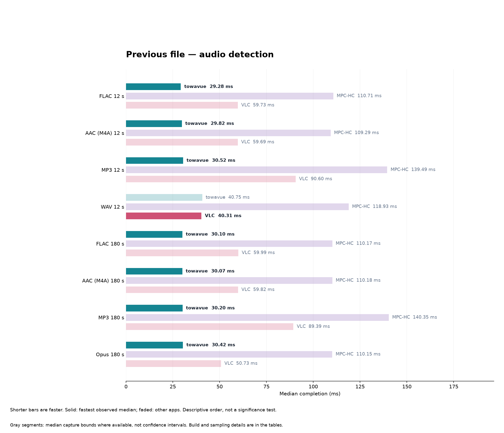

[Scalable chart](benchmarks/figures/media-previous-audio.svg)

#### Previous file — visual completion

| Fixture | towavue | MPC-HC | VLC |
|---|---:|---:|---:|
| H.264 1080p | 69.50–97.55 / 103.82 3/3; 3 blocks; study-03 | 438.25–466.65 / 468.28 3/3; 3 blocks; study-03 | 219.91–247.48 / 296.78 3/3; 3 blocks; study-03 |
| HEVC 4K 10-bit | 60.07–89.70 / 90.69 3/3; 3 blocks; study-03 | 454.55–482.23 / 488.96 3/3; 3 blocks; study-03 | 196.58–236.60 / 238.90 3/3; 3 blocks; study-03 |
| VP9 1080p | 129.13–162.62 / 172.25 3/3; 3 blocks; study-03 | 470.32–494.10 / 498.64 3/3; 3 blocks; study-03 | 179.35–204.80 / 215.10 3/3; 3 blocks; study-03 |
| AV1 4K 10-bit | 84.05–111.60 / 266.70 3/3; 3 blocks; study-03 | 466.79–490.07 / 494.95 3/3; 3 blocks; study-03 | 280.42–304.04 / 310.77 3/3; 3 blocks; study-03 |

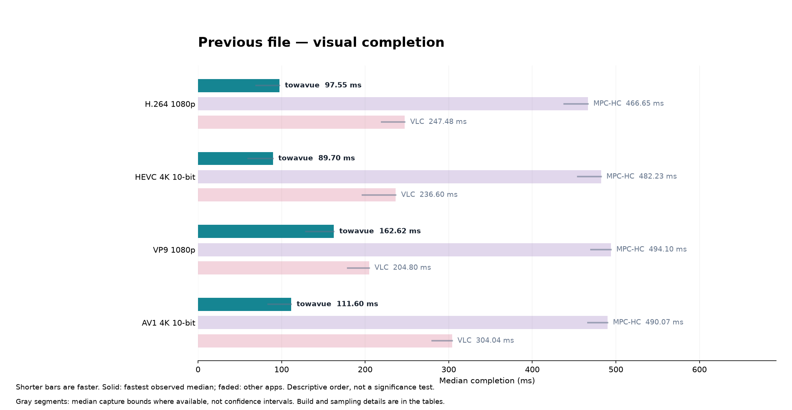

[Scalable chart](benchmarks/figures/media-previous-latency.svg)

### Open file

Another file is sent to the same running, owned window: towavue production WM_COPYDATA, IrfanView WM_DROPFILES, MPC-HC API and VLC RC. Startup and Windows dialogs are outside this measurement. Audio targets are unvisited; pausing the prior towavue tab is outside timing. Homogeneous folders and mixed sessions are distinct workloads. Six image conditions use thirty new paired blocks on 7b2422; the other cells retain ten blocks on dce8e3. The mixed refresh visits three selected targets, a narrower context than the older ten-format sequence.

#### Audio file open: 12 s — audio detection

| Fixture | towavue | MPC-HC | VLC |
|---|---:|---:|---:|
| FLAC 12 s | 20.15 / 21.32 10/10; 10 blocks; study-11 | 110.19 / 119.16 10/10; 10 blocks; study-11 | 69.92 / 71.46 10/10; 10 blocks; study-11 |
| AAC (M4A) 12 s | 24.77 / 30.10 10/10; 10 blocks; study-11 | 110.58 / 120.39 10/10; 10 blocks; study-11 | 60.08 / 60.57 10/10; 10 blocks; study-11 |
| MP3 12 s | 20.27 / 25.70 10/10; 10 blocks; study-11 | 149.12 / 150.42 10/10; 10 blocks; study-11 | 90.13 / 99.46 10/10; 10 blocks; study-11 |
| Opus 12 s | 20.81 / 29.75 10/10; 10 blocks; study-11 | 119.14 / 125.28 10/10; 10 blocks; study-11 | 69.83 / 70.82 10/10; 10 blocks; study-11 |
| WAV 12 s | 40.72 / 49.39 10/10; 10 blocks; study-11 | 121.18 / 130.62 10/10; 10 blocks; study-11 | 40.75 / 49.08 10/10; 10 blocks; study-11 |

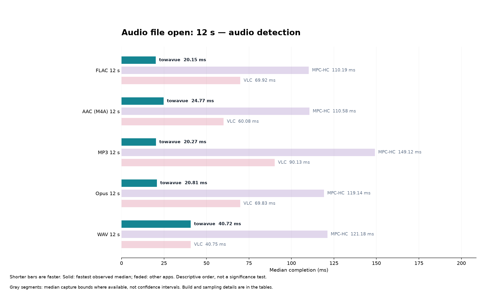

[Scalable chart](benchmarks/figures/direct-open-direct_open_audio12-audio.svg)

#### Audio file open: 180 s — audio detection

| Fixture | towavue | MPC-HC | VLC |
|---|---:|---:|---:|
| FLAC 180 s | 20.19 / 25.90 10/10; 10 blocks; study-11 | 120.39 / 130.47 10/10; 10 blocks; study-11 | 70.73 / 71.28 10/10; 10 blocks; study-11 |
| AAC (M4A) 180 s | 25.26 / 30.26 10/10; 10 blocks; study-11 | 120.53 / 130.24 10/10; 10 blocks; study-11 | 60.53 / 61.03 10/10; 10 blocks; study-11 |
| MP3 180 s | 20.67 / 30.22 10/10; 10 blocks; study-11 | 150.22 / 156.44 10/10; 10 blocks; study-11 | 90.41 / 100.33 10/10; 10 blocks; study-11 |
| Opus 180 s | 20.33 / 30.94 10/10; 10 blocks; study-11 | 120.03 / 136.18 10/10; 10 blocks; study-11 | 69.06 / 70.56 10/10; 10 blocks; study-11 |
| WAV 180 s | 40.52 / 46.11 10/10; 10 blocks; study-11 | 134.90 / 140.71 10/10; 10 blocks; study-11 | 40.26 / 42.08 10/10; 10 blocks; study-11 |

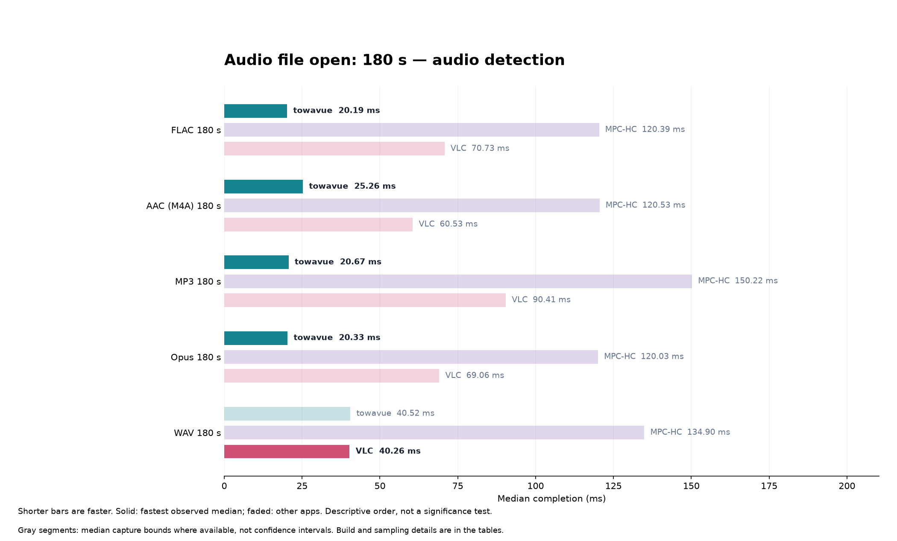

[Scalable chart](benchmarks/figures/direct-open-direct_open_audio180-audio.svg)

#### Image file open: JPEG 1080p folder — visual completion

| Fixture | towavue | IrfanView |
|---|---:|---:|
| JPEG 1080p | 0.47–26.59 / 37.87 60/60; 30 blocks; study-10 | 0.08–31.86 / 38.13 60/60; 30 blocks; study-10 |

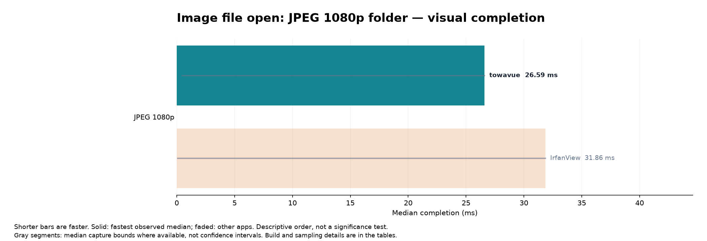

[Scalable chart](benchmarks/figures/direct-open-direct_open_jpeg1080-latency.svg)

#### Image file open: JPEG 24 MP folder — visual completion

| Fixture | towavue | IrfanView |
|---|---:|---:|
| JPEG 24 MP | 103.34–136.50 / 156.61 60/60; 30 blocks; study-10 | 101.39–136.69 / 147.16 60/60; 30 blocks; study-10 |

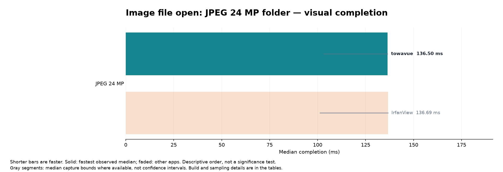

[Scalable chart](benchmarks/figures/direct-open-direct_open_jpeg24mp-latency.svg)

#### Image file open: 1,000 small JPEGs — visual completion

| Fixture | towavue | IrfanView |
|---|---:|---:|
| 1,000 small JPEGs | 0.00–18.25 / 33.63 60/60; 30 blocks; study-10 | 0.08–30.34 / 36.15 60/60; 30 blocks; study-10 |

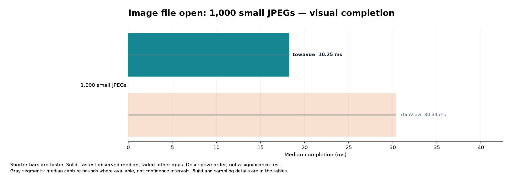

[Scalable chart](benchmarks/figures/direct-open-direct_open_large1000-latency.svg)

#### Image file open: mixed images — visual completion

| Fixture | towavue | IrfanView |
|---|---:|---:|
| JPEG 1920 x 1080 | 0.00–17.25 / 35.32 30/30; 30 blocks; study-10 | 0.08–35.70 / 39.50 30/30; 30 blocks; study-10 |
| JPEG 24 MP | 21.85–58.30 / 70.21 10/10; 10 blocks; study-11 | 103.32–134.11 / 145.39 10/10; 10 blocks; study-11 |
| PNG with alpha 4K | 1.41–37.86 / 69.94 10/10; 10 blocks; study-11 | 65.56–95.09 / 101.22 10/10; 10 blocks; study-11 |
| WebP 4K | 110.28–138.04 / 186.98 10/10; 10 blocks; study-11 | 132.36–161.64 / 170.94 10/10; 10 blocks; study-11 |
| AVIF 4K | 40.06–71.32 / 80.04 30/30; 30 blocks; study-10 | 86.76–117.97 / 123.74 30/30; 30 blocks; study-10 |
| TIFF 4K | 53.03–86.52 / 151.83 10/10; 10 blocks; study-11 | 60.96–89.55 / 97.61 10/10; 10 blocks; study-11 |
| JPEG EXIF rotation | 0.96–35.83 / 51.44 30/30; 30 blocks; study-10 | 0.08–34.38 / 38.01 30/30; 30 blocks; study-10 |
| JPEG sRGB profile 4K | 1.09–37.90 / 62.61 10/10; 10 blocks; study-11 | 33.10–63.86 / 68.14 10/10; 10 blocks; study-11 |
| Animated GIF 960 x 540 | 0.96–35.18 / 40.03 10/10; 10 blocks; study-11 | 62.10–89.50 / 99.36 10/10; 10 blocks; study-11 |
| Animated WebP 960 x 540 | 0.97–34.15 / 36.78 10/10; 10 blocks; study-11 | 32.34–59.08 / 68.67 10/10; 10 blocks; study-11 |

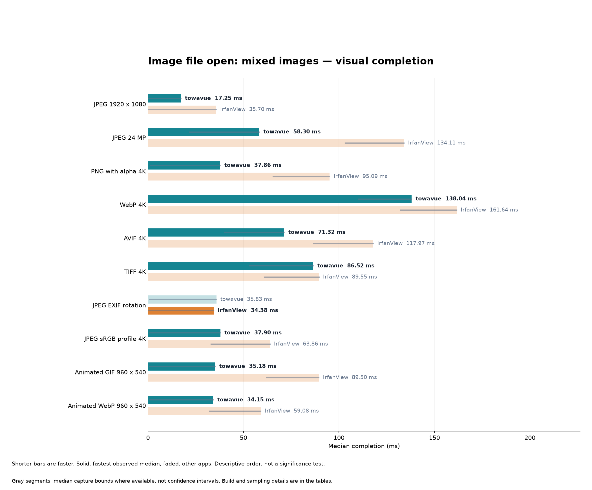

[Scalable chart](benchmarks/figures/direct-open-direct_open_mixed-latency.svg)

#### Image file open: PNG 4K folder — visual completion

| Fixture | towavue | IrfanView |
|---|---:|---:|
| PNG 4K | 35.44–67.47 / 76.74 20/20; 10 blocks; study-11 | 64.78–91.50 / 103.27 20/20; 10 blocks; study-11 |

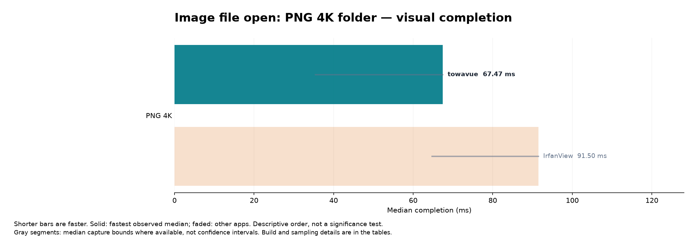

[Scalable chart](benchmarks/figures/direct-open-direct_open_png4k-latency.svg)

#### Video file open — visual completion

| Fixture | towavue | MPC-HC | VLC |
|---|---:|---:|---:|
| H.264 1080p | 65.93–97.34 / 117.84 10/10; 10 blocks; study-11 | 430.30–456.11 / 461.17 10/10; 10 blocks; study-11 | 189.47–214.31 / 225.51 10/10; 10 blocks; study-11 |
| HEVC 4K 10-bit | 51.80–81.15 / 85.55 10/10; 10 blocks; study-11 | 428.43–455.09 / 496.71 10/10; 10 blocks; study-11 | 277.42–305.51 / 310.60 10/10; 10 blocks; study-11 |
| VP9 1080p | 136.02–166.89 / 182.88 10/10; 10 blocks; study-11 | 456.42–482.00 / 489.12 10/10; 10 blocks; study-11 | 249.74–274.76 / 295.16 10/10; 10 blocks; study-11 |
| AV1 4K 10-bit | 87.07–111.91 / 288.00 10/10; 10 blocks; study-11 | 465.08–487.85 / 522.93 10/10; 10 blocks; study-11 | 292.48–318.61 / 325.43 10/10; 10 blocks; study-11 |
| H.264 1080p long GOP | 35.52–66.15 / 83.64 10/10; 10 blocks; study-11 | 419.24–442.60 / 454.70 10/10; 10 blocks; study-11 | 83.54–110.09 / 122.87 10/10; 10 blocks; study-11 |

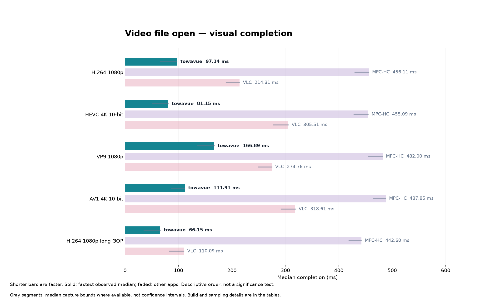

[Scalable chart](benchmarks/figures/direct-open-direct_open_video-latency.svg)

### Video soundtrack startup

Supplemental loopback-audio endpoint for video process startup; three blocks. This is not included in the audio-only startup overview.

#### Startup — audio detection

| Fixture | towavue | MPC-HC | VLC |
|---|---:|---:|---:|
| H.264 1080p | 182.53 / 182.68 3/3; 3 blocks; study-02 | 748.24 / 851.51 3/3; 3 blocks; study-02 | 448.83 / 451.45 3/3; 3 blocks; study-02 |
| HEVC 4K 10-bit | 179.51 / 182.55 3/3; 3 blocks; study-02 | 746.87 / 750.06 3/3; 3 blocks; study-02 | 477.40 / 495.03 3/3; 3 blocks; study-02 |
| VP9 1080p | 248.05 / 249.71 3/3; 3 blocks; study-02 | 785.69 / 819.17 3/3; 3 blocks; study-02 | 446.39 / 464.11 3/3; 3 blocks; study-02 |
| AV1 4K 10-bit | 177.62 / 182.46 3/3; 3 blocks; study-02 | 794.95 / 823.90 3/3; 3 blocks; study-02 | 494.64 / 494.74 3/3; 3 blocks; study-02 |
| H.264 1080p long GOP | 190.90 / 208.30 3/3; 3 blocks; study-02 | 743.26 / 789.29 3/3; 3 blocks; study-02 | 446.57 / 466.08 3/3; 3 blocks; study-02 |

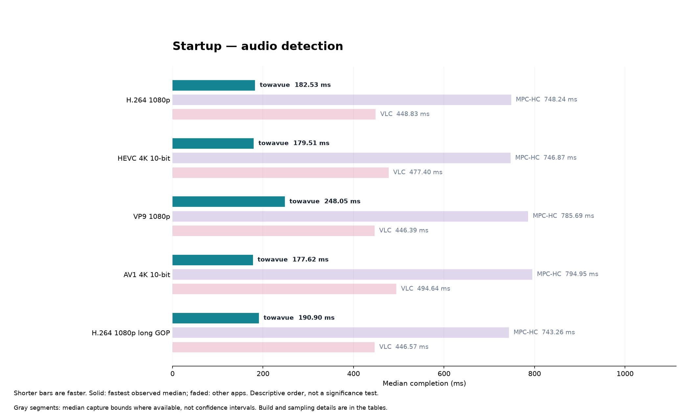

[Scalable chart](benchmarks/figures/video-audio-startup-startup-audio.svg)

### Playback cadence

Desktop capture of a 30 fps video source. These intervals should match the source cadence, so lower is not necessarily better. No winner is assigned; this supplemental endpoint is excluded from the speed overview.

#### Playback cadence — median frame interval

| Fixture | towavue | MPC-HC | VLC |
|---|---:|---:|---:|
| AV1 4K 10-bit | 33.47 / 33.58 3/3; 3 blocks; study-06 | 33.36 / 33.40 3/3; 3 blocks; study-06 | 33.45 / 33.54 3/3; 3 blocks; study-06 |
| H.264 1080p | 33.37 / 33.86 3/3; 3 blocks; study-06 | 33.38 / 33.46 3/3; 3 blocks; study-06 | 33.67 / 34.02 3/3; 3 blocks; study-06 |
| H.264 1080p long GOP | 33.70 / 33.74 3/3; 3 blocks; study-06 | 33.44 / 33.46 3/3; 3 blocks; study-06 | 33.96 / 34.50 3/3; 3 blocks; study-06 |
| HEVC 4K 10-bit | 34.13 / 34.19 3/3; 3 blocks; study-06 | 33.41 / 33.47 3/3; 3 blocks; study-06 | 33.48 / 33.51 3/3; 3 blocks; study-06 |
| VP9 1080p | 33.35 / 33.79 3/3; 3 blocks; study-06 | 33.46 / 33.52 3/3; 3 blocks; study-06 | 33.40 / 33.47 3/3; 3 blocks; study-06 |

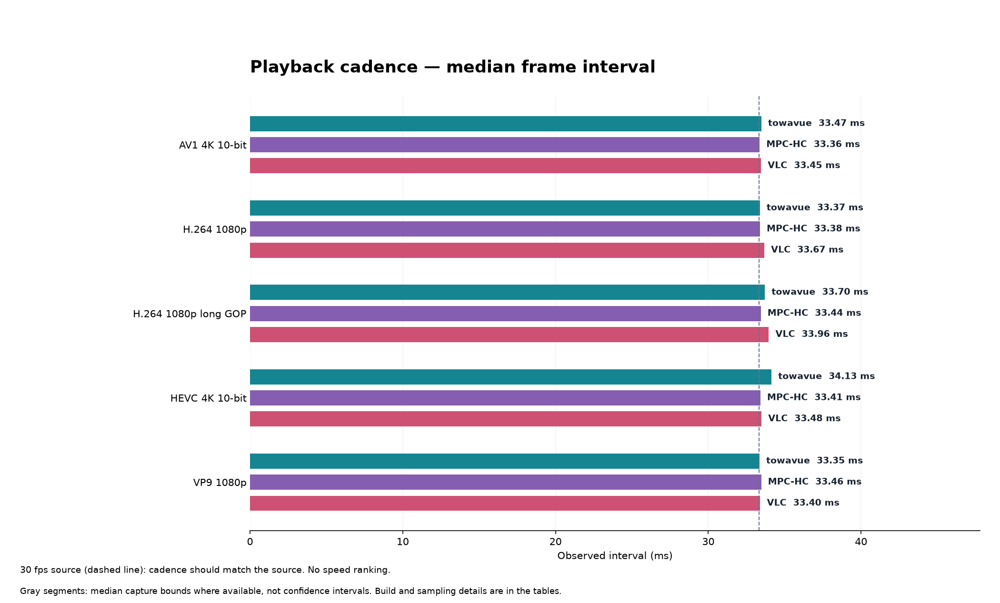

[Scalable chart](benchmarks/figures/pacing-desktop_pacing-per_trial_median_frame_interval.svg)

#### Playback cadence — p95 frame interval

| Fixture | towavue | MPC-HC | VLC |
|---|---:|---:|---:|
| AV1 4K 10-bit | 45.57 / 46.11 3/3; 3 blocks; study-06 | 36.52 / 41.55 3/3; 3 blocks; study-06 | 39.14 / 48.77 3/3; 3 blocks; study-06 |
| H.264 1080p | 36.37 / 41.87 3/3; 3 blocks; study-06 | 37.57 / 38.94 3/3; 3 blocks; study-06 | 42.62 / 47.54 3/3; 3 blocks; study-06 |
| H.264 1080p long GOP | 42.09 / 42.19 3/3; 3 blocks; study-06 | 37.75 / 39.49 3/3; 3 blocks; study-06 | 42.18 / 48.18 3/3; 3 blocks; study-06 |
| HEVC 4K 10-bit | 41.34 / 41.79 3/3; 3 blocks; study-06 | 37.48 / 37.75 3/3; 3 blocks; study-06 | 36.77 / 38.71 3/3; 3 blocks; study-06 |
| VP9 1080p | 38.60 / 41.33 3/3; 3 blocks; study-06 | 40.72 / 42.33 3/3; 3 blocks; study-06 | 37.98 / 39.48 3/3; 3 blocks; study-06 |

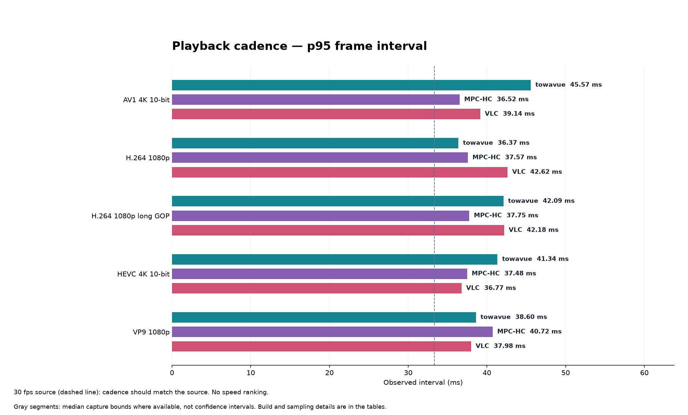

[Scalable chart](benchmarks/figures/pacing-desktop_pacing-per_trial_p95_frame_interval.svg)

## Environment and builds

| Component | Measured environment |
|---|---|
| Os | Windows 11 Home 10.0.26200 |
| Cpu | AMD Ryzen 9 9900X |
| Gpu | NVIDIA GeForce RTX 5070 Ti |
| Display | 1920 x 1080, 96 DPI |
| Recorded driver | 32.0.16.1088 |
| Recorded power plan | Balanced |
| Note | Driver and power plan are retained environment provenance, not fresh thermal controls for every session. |
| Application | Version |
|---|---|
| towavue | Integrated development Release at 34ee7fa; historical measured builds identified per cell |
| IrfanView | 4.73 x64 |
| MPC-HC | 2.5.6 with bundled LAV/MPC renderer |
| VLC | 3.0.23 |
| Photos* | 2026.11080.24002.0 |

Product integration commit: [`34ee7fa`](https://github.com/sheetau/towavue/commit/34ee7fabec9594b4b67004a70201f0dffb449e9d). These are development-build measurements, not a claim that the latest published installer has identical performance. Improvements from qualified candidates are integrated, but not every historical cell was remeasured on the integrated executable.

Build IDs below are **executable SHA-256 prefixes, not Git commits**. In each comparative study, the build identifies towavue; comparator versions are listed above.

| Build | Attribution |
|---|---|
| `7b2422` | Integrated ordinary Release; full SHA-256 7b2422336b5511fc5163584e43bb8d13004adc80fe17682ec6031932d07081cc |
| `5b91` | Qualified image-startup candidate; improvements integrated into 34ee7fa |
| `b75fc` | Qualified JPEG navigation and video/PCM-seek candidate; improvements integrated into 34ee7fa |
| `dce8e3` | Earlier direct-Open study retained for unrefreshed conditions |

### Study inventory

Study IDs connect table cells to the public data. Evidence hashes identify the archived source summaries; private machine paths, profiles and raw captures are not published.

| Study | towavue build / Photos version | Blocks | Endpoints |
|---|---|---:|---|
| study-01 | Photos 2026.11080.24002.0 | 5 | image-startup |
| study-02 | 7b2422 | 3 | audio-startup, video-audio-startup |
| study-03 | 7b2422 | 3 | media |
| study-04 | 7b2422 | 3 | mixed |
| study-05 | 7b2422 | 3 | navigation |
| study-06 | 7b2422 | 3 | pacing |
| study-07 | 7b2422 | 3 | seek |
| study-08 | 7b2422 | 3 | seek |
| study-09 | 7b2422 | 3 | video-startup |
| study-10 | 7b2422 (fixed 30-block follow-up) | 30 | direct-open |
| study-11 | dce8e3 (retained) | 10 | direct-open |
| study-12 | b75fc | 12 | seek |
| study-13 | b75fc | 10 | navigation |
| study-14 | b75fc | 10 | seek |
| study-15 | 5b91 | 30 | image-startup |

## Data and updates

[Reviewed measurement data](benchmarks/data.json) · [Overview calculation details](benchmarks/overview.json) · [Update instructions](benchmarks/README.md) · [Measurement harness](../scripts/benchmark/README.md)

This page, its figures and the README overview are generated from the reviewed public dataset. Archived measurement reports are retained as historical evidence; this page is the maintained publication. Updates replace measured conditions while preserving other comparator results and their original build/sample attribution.
